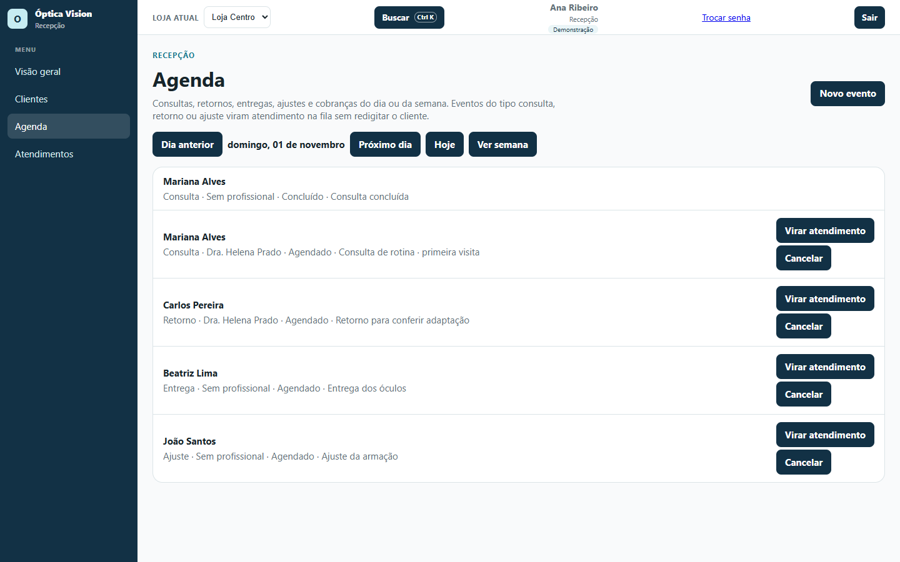
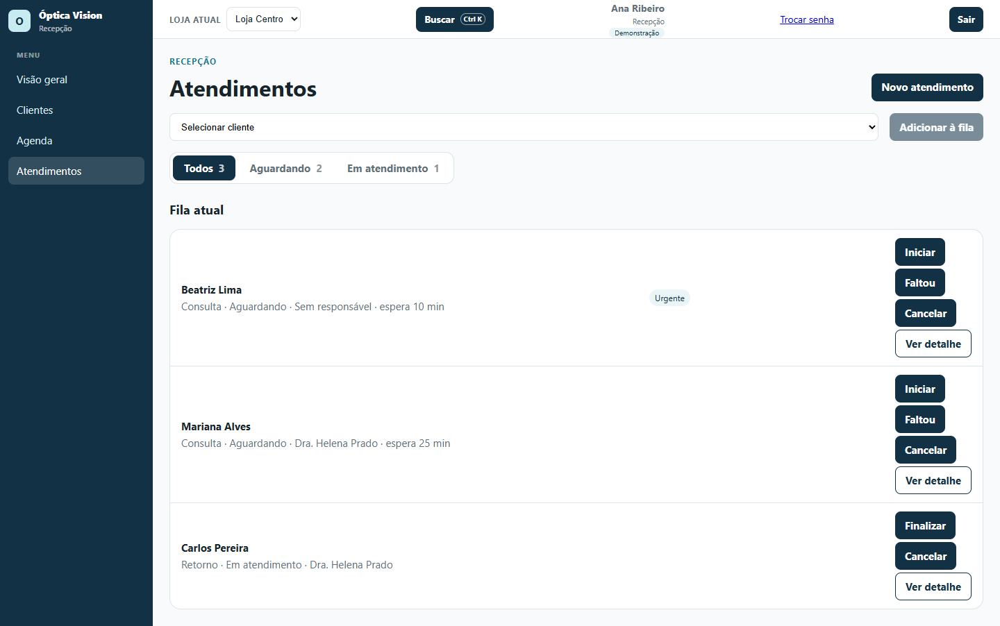
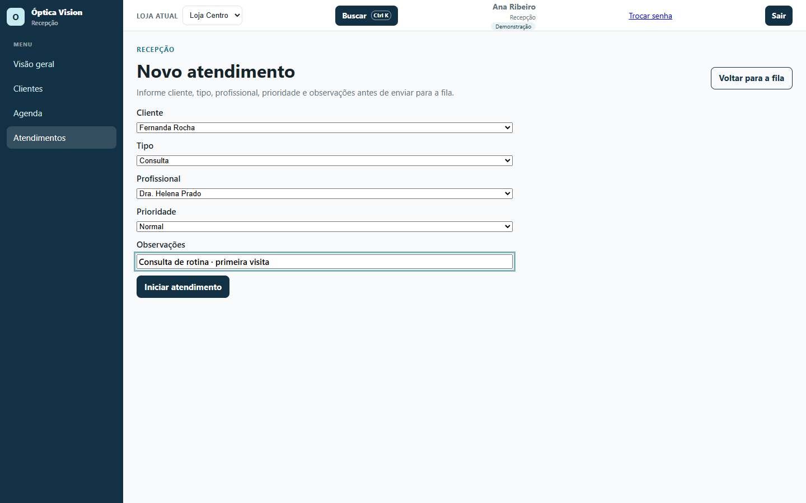
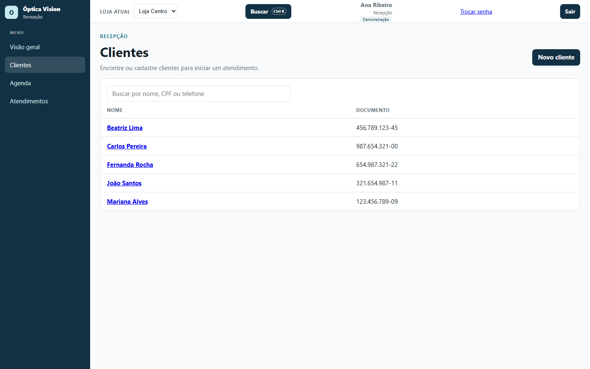
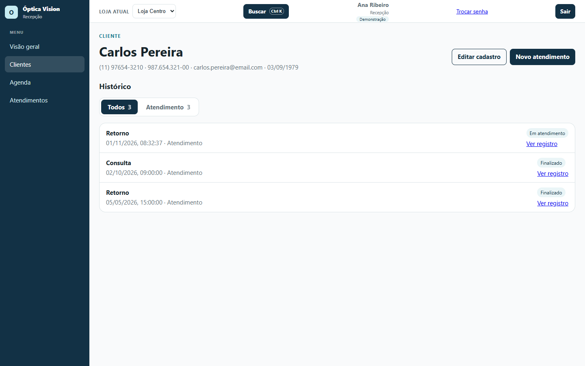

# 01 — Recepção: agenda, fila e clientes

**Para quem é:** perfil **Recepção**. Também serve para quem organiza a chegada dos clientes.

No menu você vê **Visão geral**, **Clientes**, **Agenda** e **Atendimentos**.

## 1. Conferir a agenda do dia

1. Abra **Agenda** no menu.
2. Escolha **Dia** ou **Semana** e navegue com **Dia anterior** / **Próximo dia** (ou **Semana anterior** / **Próxima semana**).
3. Use **Hoje** para voltar à data atual e **Ver semana** / **Ver dia** para trocar a visualização.
4. Cada evento mostra o cliente, o tipo, o profissional e a situação (**Agendado**, **Concluído** ou **Cancelado**).

## 2. Agendar um evento

1. Na **Agenda**, clique em **Novo evento**.
2. Preencha:
   - **Cliente**;
   - **Profissional** (opcional; deixe **Sem profissional** quando não houver);
   - **Tipo**: **Consulta**, **Retorno**, **Entrega**, **Ajuste** ou **Cobrança**;
   - **Data e hora**;
   - **Observações** (opcional).
3. Clique em **Agendar**. O evento aparece no dia escolhido.
4. Para desmarcar, use **Cancelar** no evento agendado.

> **Consulta**, **Retorno** e **Ajuste** podem virar atendimento na fila. **Entrega** e **Cobrança** são compromissos da agenda e não viram atendimento.

## 3. Transformar um evento em atendimento

1. No evento do tipo **Consulta**, **Retorno** ou **Ajuste**, clique em **Virar atendimento**.
2. O cliente é reaproveitado, sem redigitar os dados, e o atendimento entra na fila como **Aguardando**.
3. A tela vai para a fila já com o cliente selecionado.
4. Um evento concluído ou cancelado não vira atendimento de novo.

## 4. Trabalhar na fila

1. Abra **Atendimentos**.
2. Use os filtros **Todos**, **Aguardando** e **Em atendimento** para ver a fila.
3. Para incluir alguém rapidamente, selecione o cliente em **Selecionar cliente** e clique em **Adicionar à fila**.
4. Em cada atendimento:
   - **Iniciar**: o cliente começou o atendimento;
   - **Faltou**: o cliente não compareceu;
   - **Finalizar**: o atendimento terminou;
   - **Cancelar**: o atendimento foi cancelado;
   - **Ver detalhe**: abre a ficha do atendimento.
5. A fila mostra o tempo de espera. Atendimentos marcados como **Urgente** aparecem com esse aviso.

## 5. Criar um atendimento completo

Use quando o cliente chega sem evento na agenda ou quando precisa registrar tipo, profissional e prioridade.

1. Em **Atendimentos**, clique em **Novo atendimento**.
2. Preencha **Cliente**, **Tipo** (**Consulta**, **Retorno**, **Ajuste** ou **Avaliação**), **Profissional** (opcional), **Prioridade** (**Normal** ou **Urgente**) e **Observações**.
3. Clique em **Iniciar atendimento**.
4. Para voltar sem criar, use **Voltar para a fila**.

## 6. Encontrar e cadastrar clientes

1. Abra **Clientes**.
2. Digite no campo **Buscar por nome, CPF ou telefone**. A lista é paginada.
3. Clique em **Novo cliente** para cadastrar. Informe **Nome completo**, **Telefone** e **CPF/CNPJ**.
4. Se o sistema avisar que existe um cliente parecido, confira antes de continuar. Para cadastrar mesmo assim, informe o motivo em **Cadastrar mesmo assim**.
5. Ao salvar, você pode ir direto para a fila com **Salvar e iniciar atendimento**.

## 7. Ver a ficha do cliente

1. Clique no nome do cliente na lista.
2. A ficha mostra os dados de contato e o **Histórico** de atendimentos.
3. Use **Editar cadastro** para corrigir nome, telefone, CPF/CNPJ, e-mail e data de nascimento.
4. Use **Novo atendimento** para colocar o cliente na fila.
5. O que aparece no histórico depende do seu perfil. A recepção vê os atendimentos; vendas, ordens e dados clínicos aparecem para quem tem essa permissão.

## Rotina sugerida

- **Manhã:** confira a agenda do dia, veja quem já chegou e vire os eventos em atendimento.
- **Durante o dia:** mantenha a fila atualizada (**Iniciar**, **Faltou**, **Finalizar**) e cadastre clientes novos.
- **Fim do dia:** confira os eventos concluídos e os atendimentos que ficaram aguardando.

## Dicas

- Use **Ctrl K** para achar um cliente ou uma tela sem passar pelo menu.
- O botão **"?"** nas telas críticas explica o que cada campo faz.
- Antes de cancelar um atendimento, confirme com o cliente e com a equipe: o cancelamento fica registrado.
- A agenda e a fila são da **loja atual** selecionada no topo. Confira a loja antes de agendar.
