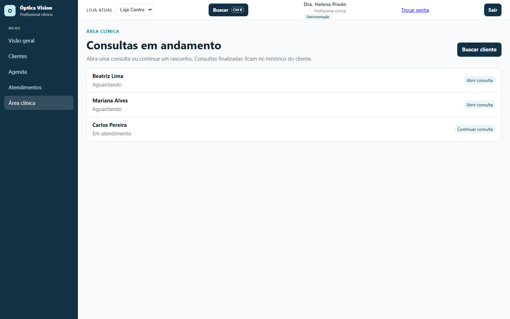
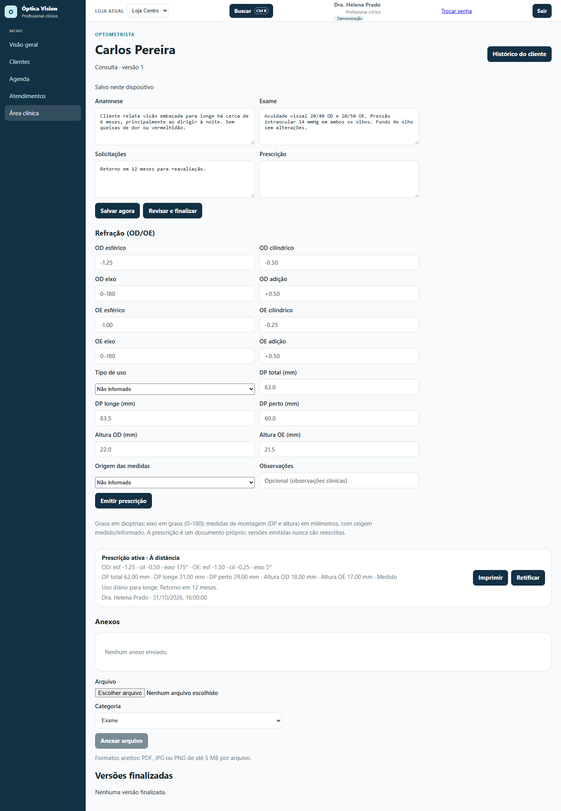
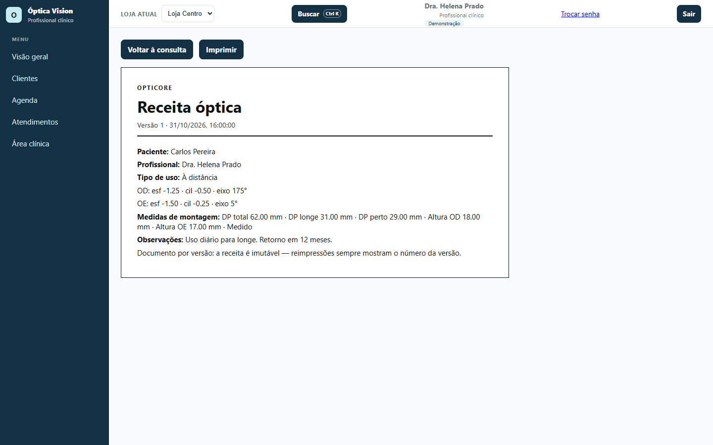

# 02 — Clínico: consulta, prescrição e receita

**Para quem é:** perfil **Profissional clínico**. Também serve para quem acompanha prontuários e prescrições.

No menu você vê **Visão geral**, **Clientes**, **Agenda**, **Atendimentos** e **Área clínica**.

## 1. Abrir uma consulta

1. Abra **Área clínica**.
2. A tela **Consultas em andamento** lista quem está **Aguardando** e quem está **Em atendimento**.
3. Clique em **Abrir consulta** para um cliente que ainda não começou ou em **Continuar consulta** para retomar um rascunho.
4. Se precisar procurar outro cliente, use **Buscar cliente**.

## 2. Preencher o prontuário

Na consulta, os campos ficam na ordem:

- **Anamnese:** queixa e histórico relatados pelo cliente;
- **Exame:** resultados do exame realizado;
- **Solicitações:** pedidos e orientações;
- **Prescrição:** observações livres da consulta.

O sistema salva automaticamente enquanto você digita. O aviso no topo mostra **Salvando…**, **Salvo neste dispositivo** ou **As alterações serão salvas automaticamente**.

1. Preencha os campos.
2. Use **Salvar agora** para forçar a gravação.
3. Use **Histórico do cliente** para consultar atendimentos anteriores.

## 3. Registrar a refração (OD/OE)

Na seção **Refração (OD/OE)**, preencha para cada olho:

- **Esférico**, **cilíndrico**, **eixo** (0–180) e **adição**;
- **Tipo de uso**: **À distância**, **À perto**, **Uso contínuo** ou **Multifocal**;
- **DP total**, **DP longe**, **DP perto**, **Altura OD** e **Altura OE**, em milímetros;
- **Origem das medidas**: **Medido** ou **Informado**;
- **Observações** clínicas (opcional).

Graus ficam em dioptrias; eixo em graus; medidas de montagem em milímetros. Deixe em branco o que não se aplica.

## 4. Emitir a prescrição

1. Depois de preencher a refração, clique em **Emitir prescrição**.
2. A prescrição aparece como **Prescrição ativa**, com os graus, as medidas, o tipo de uso, o autor e a data.
3. Use **Imprimir** para abrir a **Receita óptica**.
4. Use **Retificar** quando precisar corrigir uma prescrição já emitida.

> Cada emissão é uma **versão**. Versões emitidas não são reescritas: uma correção cria uma nova versão e mantém a anterior no histórico, com autor, data e motivo.

## 5. Retificar uma prescrição

1. Na prescrição ativa, clique em **Retificar**.
2. Os campos são preenchidos com os dados atuais.
3. Informe o **Motivo da retificação** (obrigatório).
4. Clique em **Retificar (versão 2)** (o número acompanha a versão).
5. Para desistir, use **Cancelar retificação**.
6. A versão anterior continua visível na lista e no histórico.

## 6. Anexar exames e documentos

1. Na seção **Anexos**, escolha o **Arquivo** (PDF, JPG ou PNG de até 5 MB).
2. Selecione a **Categoria**: **Exame**, **Imagem** ou **Documento**.
3. Clique em **Anexar arquivo**.
4. Use **Prévia** para abrir o arquivo e **Excluir** para removê-lo enquanto a consulta não estiver finalizada.

## 7. Finalizar a consulta

1. Revise os campos.
2. Clique em **Revisar e finalizar**.
3. Confira o aviso **Confirmar finalização** e clique em **Confirmar finalização**.
4. A consulta passa a ser somente leitura. O atendimento é concluído e a versão fica em **Versões finalizadas**.
5. Se precisar corrigir depois, use **Corrigir documento**, informe o **Motivo da correção** e clique em **Criar nova versão**. O original permanece no histórico.

## 8. Imprimir a receita óptica

1. Na lista de prescrições, clique em **Imprimir** na versão desejada.
2. A página **Receita óptica** mostra paciente, profissional, tipo de uso, graus OD/OE, medidas de montagem, observações e o número da versão.
3. Na página da receita, clique em **Imprimir** para abrir a impressão do navegador. A barra lateral e os botões não saem na impressão.
4. Use **Voltar à consulta** para retornar ao prontuário.

## Dicas

- A prescrição é um documento por versão: reimpressões sempre mostram o número correto.
- O botão **"?"** nas telas críticas explica campos e fluxos.
- Use **Ctrl K** para localizar rapidamente um cliente ou uma tela.
- A consulta é da **loja atual**; confira a loja no topo antes de atender.
