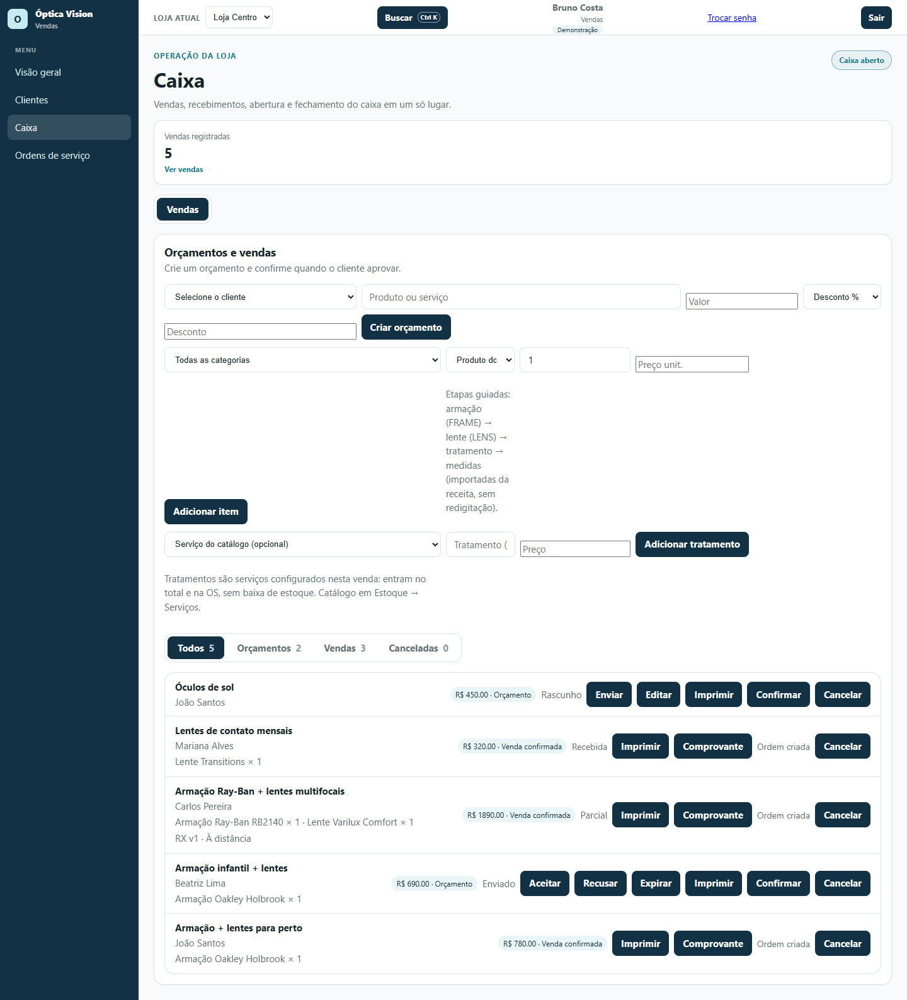
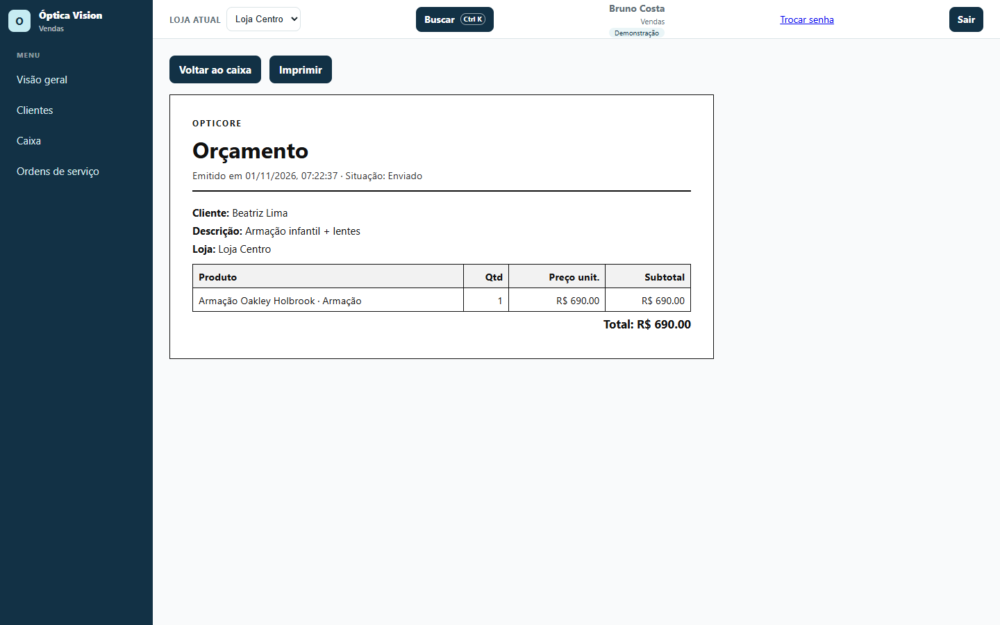

# 03 — Vendas: orçamento, desconto e ordem de serviço

**Para quem é:** perfil **Vendas**. Também serve para quem monta orçamentos e acompanha a aprovação do cliente.

No menu você vê **Visão geral**, **Clientes**, **Caixa** e **Ordens de serviço**.

## 1. Abrir a área de vendas

1. Abra **Caixa** no menu.
2. O perfil Vendas entra direto na aba **Vendas**, com o painel **Orçamentos e vendas**.
3. A lista mostra **Todos**, **Orçamentos**, **Vendas** e **Canceladas**, com a situação de cada registro.

## 2. Criar um orçamento

1. Em **Orçamentos e vendas**, selecione o **Cliente**.
2. Se o cliente tiver prescrição, escolha a **Prescrição** (por exemplo, **Rx v1 · À distância**). Os graus e as medidas entram na venda sem redigitar.
3. Em **Produto ou serviço**, descreva o que está sendo vendido.
4. Informe o **Valor**.
5. Se houver desconto, escolha **Desconto %** ou **Desconto R$**, informe o valor e o **Motivo do desconto** (recomendado).
6. Clique em **Criar orçamento**.

> O sistema mostra o valor bruto, o desconto e o total final. Se o desconto passar do seu limite, o orçamento fica **Aguardando aprovação** e um perfil autorizado precisa clicar em **Aprovar desconto**.

## 3. Adicionar produtos e tratamentos

Para montar a venda item a item:

1. Em **Produto do estoque**, escolha a categoria e o produto. O sistema mostra o saldo disponível.
2. Informe a **Quantidade** e o **Preço unitário**.
3. Clique em **Adicionar item**. Repita para armação, lente e outros itens.
4. Para serviços (montagem, ajuste, exame particular), escolha o **Serviço do catálogo** ou digite o **Nome do tratamento** e o **Preço**, e clique em **Adicionar tratamento**.
5. Use **Remover** para tirar um item ou tratamento antes de confirmar.

As etapas guiadas seguem a ordem **armação → lente → tratamento → medidas**. O catálogo de serviços fica em **Estoque → Serviços**.

## 4. Enviar, aceitar e confirmar

O orçamento passa por etapas:

1. **Rascunho:** ainda pode ser editado. Use **Enviar** quando estiver pronto para o cliente.
2. **Enviado:** use **Aceitar** quando o cliente aprovar, **Recusar** se ele recusar ou **Expirar** se o prazo vencer.
3. **Aceito:** use **Confirmar** para transformar o orçamento em venda confirmada.
4. **Confirmada:** a venda passa a ter saldo a receber e pode gerar uma ordem de serviço.

Enquanto o orçamento está em rascunho, use **Editar** para alterar. Para imprimir a proposta, use **Imprimir**.

> O orçamento precisa estar em negociação ou aceito para ser confirmado. Orçamento recusado ou expirado não pode ser confirmado.

## 5. Imprimir o orçamento

1. Na lista, clique em **Imprimir** no orçamento.
2. A página **Orçamento** mostra cliente, descrição, loja, itens, quantidades, preços, total e a situação.
3. Clique em **Imprimir** para abrir a impressão do navegador.

## 6. Gerar a ordem de serviço

Depois de confirmar a venda:

1. Na lista, clique em **Criar ordem** (ou abra **Ordens de serviço** e use a seção **Vendas confirmadas sem ordem**).
2. A ordem nasce com os dados da venda: cliente, itens, prescrição e valores.
3. Acompanhe a produção em **Ordens de serviço**. O laboratório, as etapas e a entrega são registrados lá.

## 7. Receber e cancelar

- O **recebimento** é feito pelo **Caixa**. O vendedor acompanha a situação na lista (**Recebida**, **Parcial**) e pode abrir o **Comprovante**.
- Para **cancelar** um orçamento ou uma venda, clique em **Cancelar**, informe o **Motivo** e confirme. Uma venda já paga pode gerar estorno no caixa; o estoque é devolvido.

## Dicas

- Use **Ctrl K** para encontrar uma venda, um cliente ou uma ordem.
- O botão **"?"** nas telas críticas explica o fluxo da OS e os recebimentos parciais.
- Confira a **loja atual** no topo: o orçamento e o estoque são da loja selecionada.
- Antes de confirmar, confira cliente, itens, graus da prescrição e total com desconto.
