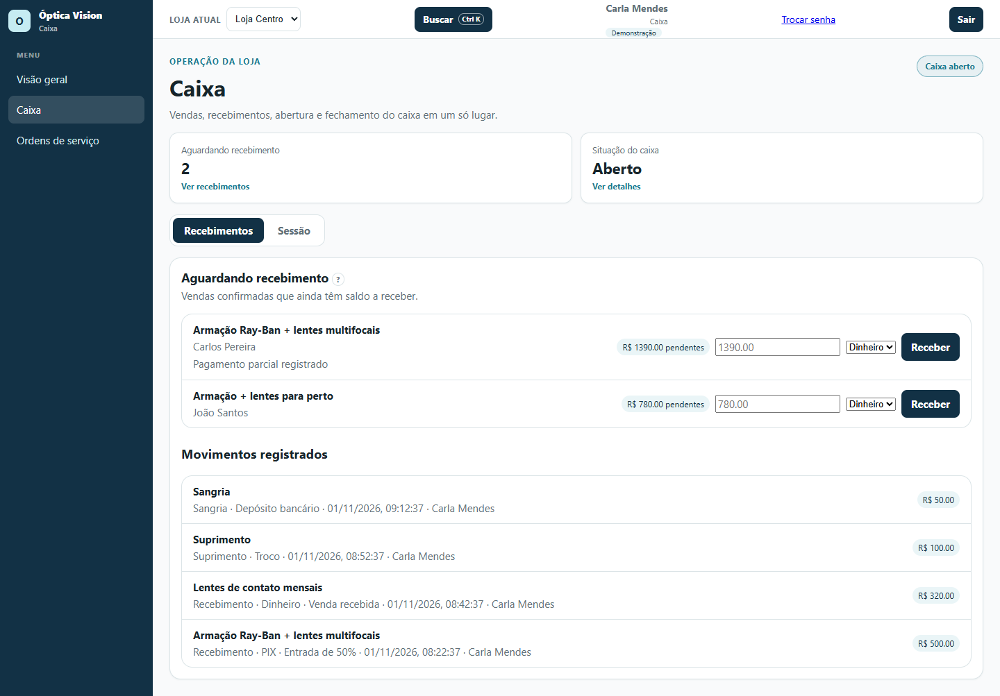
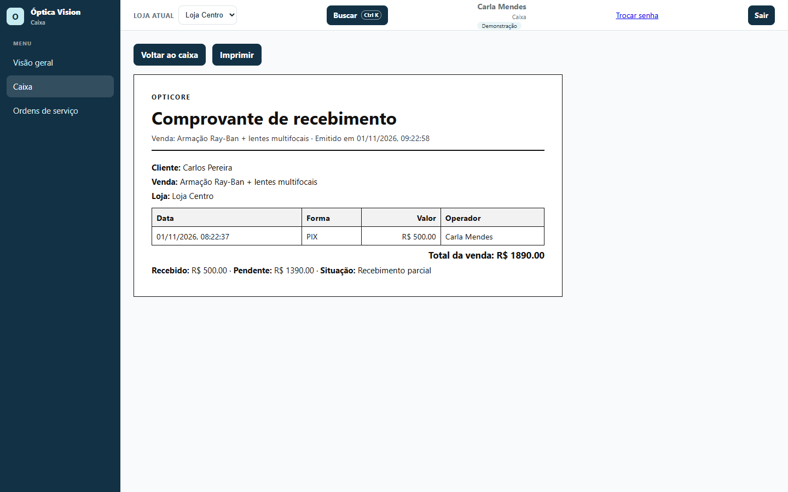
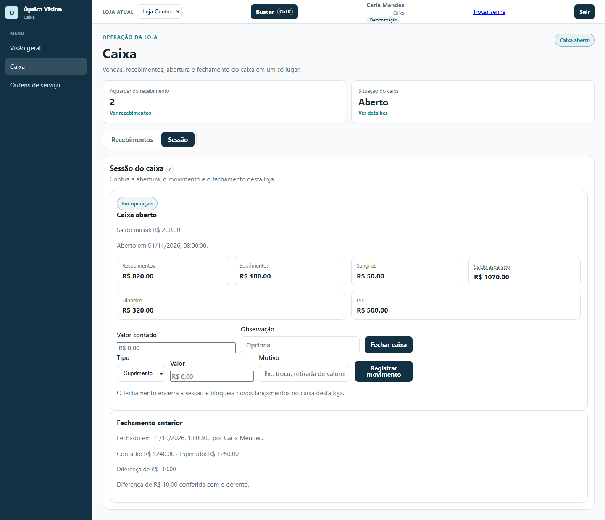

# 04 — Caixa: recebimentos, sessão e fechamento

**Para quem é:** perfil **Caixa**. Também serve para quem confere o dinheiro e os recebimentos da loja.

No menu você vê **Visão geral**, **Caixa** e **Ordens de serviço**.

## 1. Entender a tela do caixa

A tela **Caixa** reúne vendas, recebimentos, abertura e fechamento. No topo aparecem os cartões:

- **Aguardando recebimento:** quantas vendas confirmadas ainda têm saldo;
- **Situação do caixa:** **Aberto** ou **Fechado**.

As abas disponíveis para o perfil Caixa são **Recebimentos** e **Sessão**.

## 2. Abrir o caixa

O caixa precisa estar aberto para receber pagamentos e registrar movimentos.

1. Abra a aba **Sessão**.
2. Se o caixa estiver fechado, informe o **Saldo inicial** (o dinheiro que já existe na gaveta).
3. Clique em **Abrir caixa**.
4. O cartão passa a mostrar **Caixa aberto**, **Em operação**, o saldo inicial e a data/hora da abertura.

## 3. Receber uma venda

1. Abra a aba **Recebimentos**.
2. Em **Aguardando recebimento**, localize a venda pelo cliente e pela descrição.
3. Confira o valor pendente no selo (por exemplo, **R$ 1390,00 pendentes**).
4. Informe o **Valor a receber**. Pode ser o valor total ou uma parte.
5. Escolha a **Forma de pagamento**: **Dinheiro**, **PIX**, **Cartão**, **Débito** ou **Crédito**.
6. Se for **PIX**, preencha a **Referência PIX** (opcional). Se for **Dinheiro**, o sistema mostra o **Troco** quando o valor recebido passa do saldo.
7. Clique em **Receber**. O valor entra em **Movimentos registrados** e o saldo da venda é atualizado.

> É possível receber parte do valor várias vezes até quitar a venda. Cada baixa vira um movimento de caixa. O sistema bloqueia recebimento acima do saldo.

## 4. Emitir o comprovante

1. Na lista de vendas, clique em **Comprovante** na venda confirmada.
2. O **Comprovante de recebimento** mostra cliente, venda, loja, data, forma de pagamento, valor, operador, total da venda, valor recebido, pendente e situação.
3. Clique em **Imprimir** para abrir a impressão do navegador.
4. Use **Voltar ao caixa** para retornar.

## 5. Registrar suprimento e sangria

Na aba **Sessão**, com o caixa aberto:

1. Em **Tipo**, escolha **Suprimento** (entrada de dinheiro) ou **Sangria** (retirada).
2. Informe o **Valor**.
3. Informe o **Motivo** (obrigatório), por exemplo "troco" ou "depósito bancário".
4. Clique em **Registrar movimento**.

O **Saldo esperado** é calculado assim: saldo inicial + recebimentos + suprimentos − sangrias − estornos.

## 6. Fechar o caixa

1. Na aba **Sessão**, confira os totais de **Recebimentos**, **Suprimentos**, **Sangrias**, **Estornos** e **Saldo esperado**.
2. Confira também os totais por forma de pagamento (**Dinheiro**, **PIX** e outras).
3. No formulário de fechamento, informe o **Valor contado** (o dinheiro conferido na gaveta).
4. Se necessário, escreva uma **Observação**.
5. Clique em **Fechar caixa**.

O fechamento encerra a sessão e bloqueia novos lançamentos no caixa desta loja. Se o valor contado for diferente do esperado, a diferença fica registrada no **Fechamento anterior**, com data, responsável e observação.

## Dicas

- O botão **"?"** em **Aguardando recebimento** e em **Sessão do caixa** explica recebimentos parciais e saldo esperado.
- Confira a **loja atual** no topo antes de abrir ou fechar o caixa.
- O caixa é por loja: cada loja tem a própria sessão.
- Guarde o comprovante impresso ou digitalizado quando o cliente pedir.
- O perfil Caixa não vê a aba **Vendas**; o vendedor não vê **Recebimentos** nem **Sessão**. Cada um faz a sua parte.
