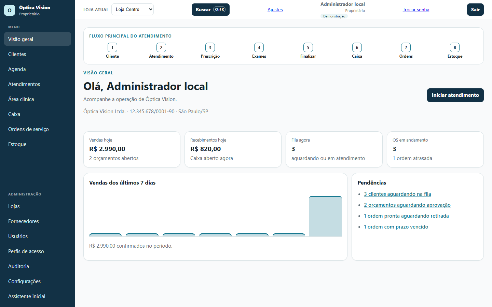
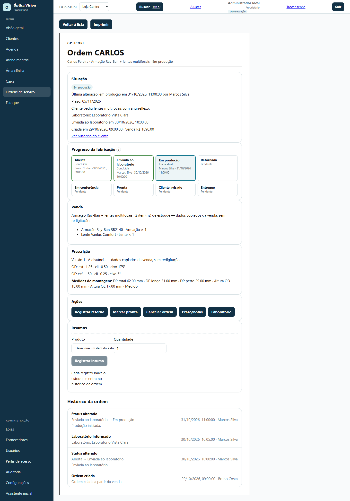
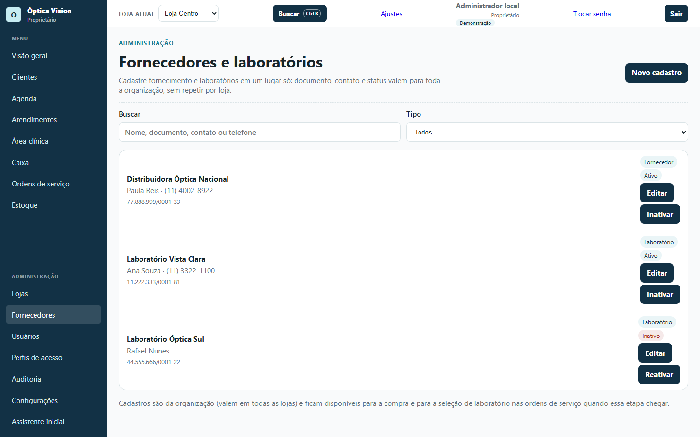
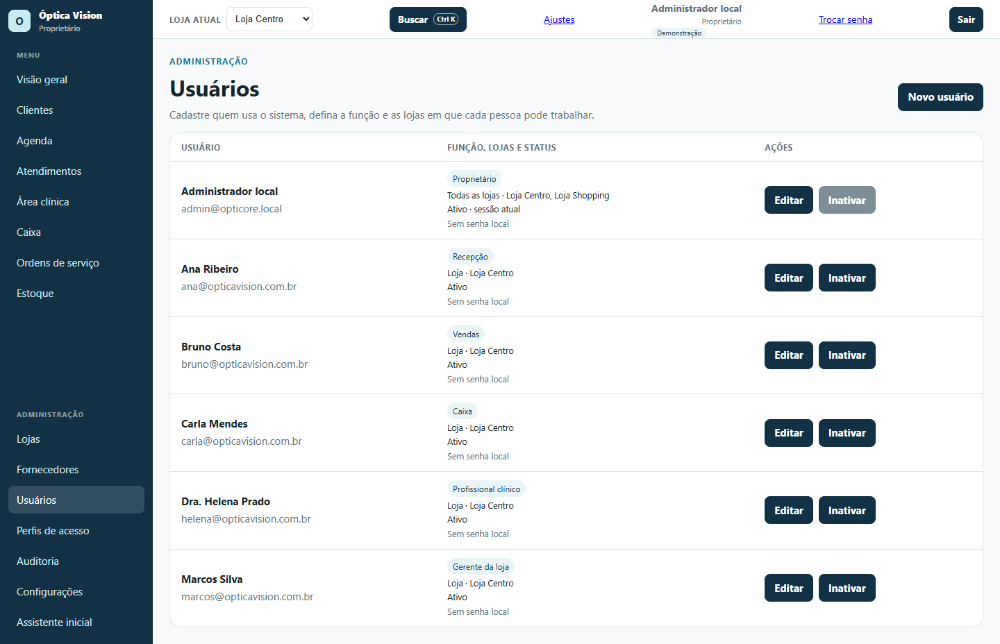
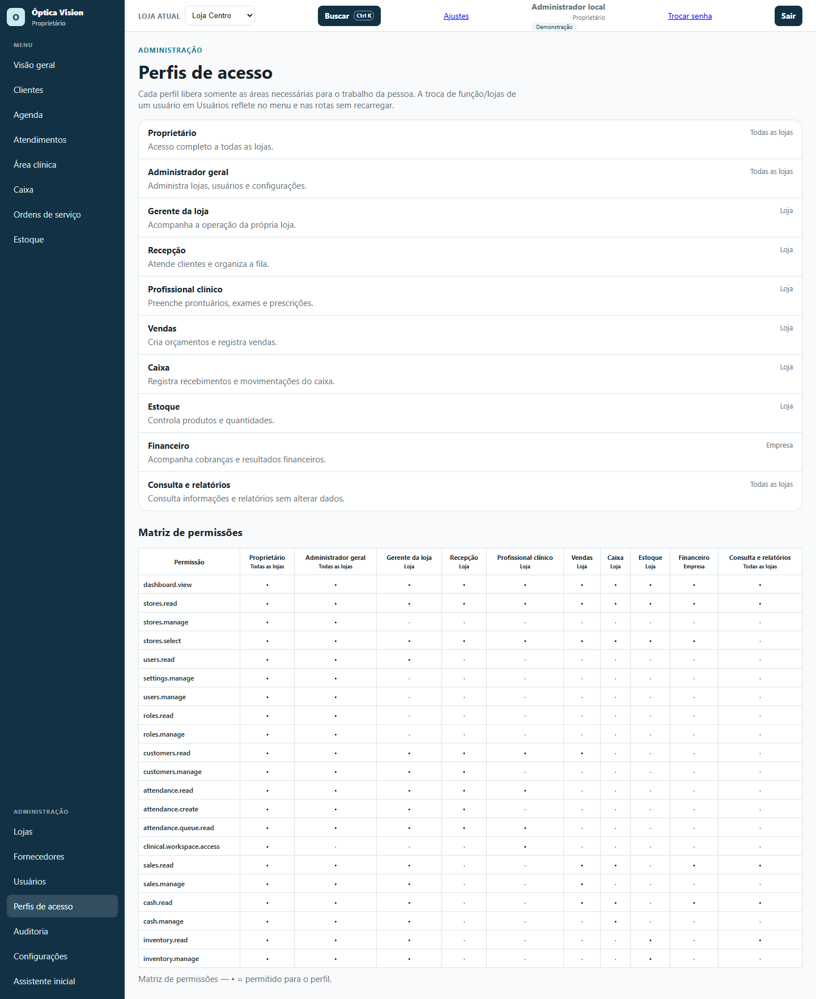
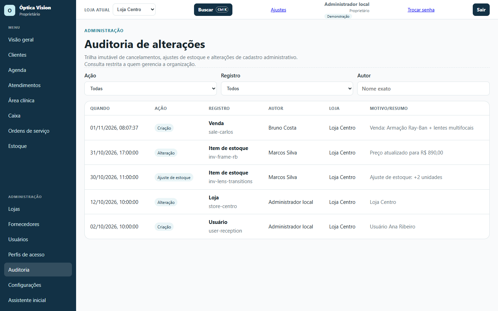
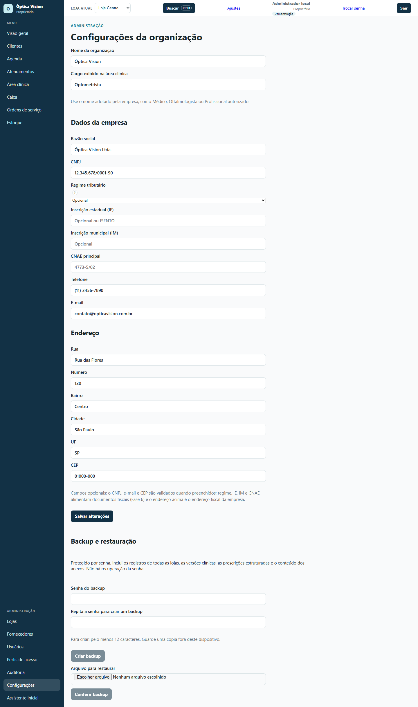
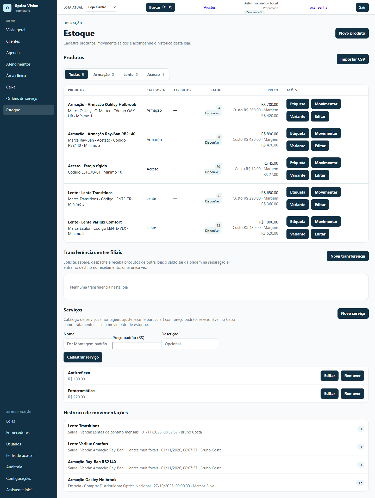

# 05 — Gestão: visão geral, ordens, administração e estoque

**Para quem é:** **Proprietário**, **Administrador geral**, **Gerente da loja** e **Financeiro**. Cada perfil vê as áreas liberadas.

## 1. Acompanhar a operação na Visão geral

1. Abra **Visão geral**.
2. No topo, o **Fluxo principal do atendimento** mostra as etapas: **Cliente → Atendimento → Prescrição → Exames → Finalizar → Caixa → Ordens → Estoque**. Clique em uma etapa para ir à área correspondente.
3. Os cartões mostram os indicadores do perfil: **Vendas hoje**, **Recebimentos hoje**, **Fila agora**, **Retornos hoje**, **OS em andamento** e **Estoque em alerta**.
4. O gráfico **Vendas dos últimos 7 dias** mostra o total confirmado no período.
5. Em **Pendências**, clique em cada item para resolver: clientes na fila, orçamentos aguardando aprovação, ordens prontas, ordens com prazo vencido, produtos no mínimo e caixa não aberto.

## 2. Acompanhar as ordens de serviço

1. Abra **Ordens de serviço**.
2. Use os filtros **Todas**, **Prontos p/ retirada**, **Atrasadas** e os status (**Aberta**, **Enviada ao laboratório**, **Em produção**, **Retornada**, **Em conferência**, **Pronta**, **Cliente avisado**, **Entregue**, **Cancelada**).
3. Vendas confirmadas sem ordem aparecem em **Vendas confirmadas sem ordem**; clique em **Criar ordem** para gerar a OS.
4. Abra **Detalhes** para ver a **Situação**, o **Progresso da fabricação**, a **Venda**, a **Prescrição**, as **Ações**, os **Insumos** e o **Histórico da ordem**.

Na OS, as ações disponíveis dependem do status:

- **Enviar ao laboratório** e **Iniciar produção**;
- **Registrar retorno** e **Iniciar conferência**;
- **Marcar pronta** e **Avisar cliente**;
- **Registrar entrega** (informe **Recebido por**; se houver saldo pendente, confirme o aviso);
- **Prazo/notas** para ajustar prazo e observações;
- **Laboratório** para escolher um laboratório **ativo** do cadastro;
- **Cancelar ordem** com motivo obrigatório.

Cada etapa grava quem fez e quando. Voltar de etapa preserva o histórico. Os **Insumos** baixam o estoque e entram no histórico da ordem.

## 3. Cadastrar fornecedores e laboratórios

1. Abra **Administração → Fornecedores**.
2. Clique em **Novo cadastro**.
3. Informe **Tipo** (**Fornecedor** ou **Laboratório**), **Nome**, **Documento**, contato, telefone, e-mail e observações.
4. Use a busca por nome, documento, contato ou telefone e o filtro **Tipo**.
5. **Editar** altera o cadastro; **Inativar** tira o registro das seleções sem apagar o histórico; **Reativar** devolve.

O cadastro vale para toda a organização. Só laboratórios **ativos** aparecem no seletor de laboratório da OS.

## 4. Gerenciar usuários

1. Abra **Administração → Usuários**.
2. Clique em **Novo usuário**.
3. Informe **Nome**, **E-mail**, **Senha** (opcional; mínimo de 8 caracteres), **Função** e as **Lojas autorizadas**.
4. Clique em **Criar usuário**. Para alterar, use **Editar**; para tirar o acesso sem apagar o histórico, use **Inativar**.
5. A **Função** define as permissões; as **Lojas** definem onde a pessoa pode trabalhar. A mudança reflete no menu e nas rotas sem recarregar a página.

> Sem senha, o usuário só entra pelo **modo demonstração**. Defina uma senha para o acesso normal com e-mail e senha.

## 5. Conferir os perfis de acesso

1. Abra **Administração → Perfis de acesso**.
2. A lista descreve cada perfil: **Proprietário**, **Administrador geral**, **Gerente da loja**, **Recepção**, **Profissional clínico**, **Vendas**, **Caixa**, **Estoque**, **Financeiro** e **Consulta e relatórios**.
3. A **Matriz de permissões** mostra o que cada perfil pode fazer. Use-a para conceder o mínimo necessário.

## 6. Consultar a auditoria

1. Abra **Administração → Auditoria**.
2. Filtre por **Ação**, **Registro** e **Autor** (nome exato).
3. A tabela mostra **Quando**, **Ação**, **Registro**, **Autor**, **Loja** e **Motivo/resumo**.

A auditoria é uma trilha imutável de cancelamentos, ajustes de estoque e alterações de cadastro administrativo. A consulta é restrita a quem gerencia a organização.

## 7. Configurar a organização e fazer backup

1. Abra **Administração → Configurações**.
2. Em **Dados da empresa**, confira **Nome da organização**, **Cargo exibido na área clínica**, **Razão social**, **CNPJ**, **Regime tributário**, inscrições, **CNAE**, telefone e e-mail.
3. Em **Endereço**, complete rua, número, bairro, cidade, UF e CEP.
4. Clique em **Salvar alterações**.
5. Em **Backup e restauração**, defina uma **Senha do backup** (mínimo de 12 caracteres) e repita a senha. Clique em **Criar backup** e guarde o arquivo.
6. Para restaurar, escolha o **Arquivo para restaurar**, clique em **Conferir backup** e siga a confirmação.

> A senha do backup **não pode ser recuperada**. Guarde o arquivo e a senha em local seguro. O backup inclui os registros de todas as lojas, as versões clínicas, as prescrições e o conteúdo dos anexos.

## 8. Controlar o estoque

1. Abra **Estoque**.
2. Use os filtros **Todas**, **Armação**, **Lente** e **Acesso** para ver os produtos.
3. **Novo produto**: informe produto, código, categoria, saldo inicial, estoque mínimo, preço, custo, marca, material e dados fiscais opcionais.
4. **Movimentar**: escolha **Entrada**, **Saída** ou **Ajuste (com sinal)**, informe a quantidade e o **Motivo**. O saldo não é editado direto no cadastro.
5. **Variante**: cria um item de estoque próprio, com saldo e movimentações separados.
6. **Importar CSV**: baixe o modelo em [`IMPORT_EXAMPLE.csv`](../product/IMPORT_EXAMPLE.csv), escolha o arquivo, confira a prévia e importe. Linhas com erro ou duplicadas são ignoradas.
7. **Transferências entre filiais**: solicite, separe, despache e receba produtos de outra loja.
8. **Serviços**: cadastre montagem, ajuste, exame particular e outros serviços com preço padrão. Eles aparecem no Caixa como tratamento, sem baixar estoque.
9. **Etiqueta**: abre a etiqueta do produto para impressão.

## Rotina sugerida

- **Abertura:** confira as pendências da Visão geral e se o caixa foi aberto.
- **Durante o dia:** acompanhe fila, orçamentos aguardando aprovação, ordens atrasadas e estoque em alerta.
- **Fechamento:** confira o caixa, as ordens prontas e faça o backup.
- **Semanal:** revise usuários e perfis, fornecedores e produtos no mínimo.

## Dicas

- Use **Ctrl K** para localizar rapidamente uma tela, cliente, produto, venda ou OS.
- O botão **"?"** nas telas críticas explica o fluxo da OS, as etapas e os dados fiscais.
- A **loja atual** no topo define os dados de agenda, fila, caixa, estoque e ordens.
- Antes de inativar um usuário, confira se ele não é o único responsável por uma operação em andamento.
- Faça backup antes de mudanças grandes de cadastro ou de importação de produtos.
